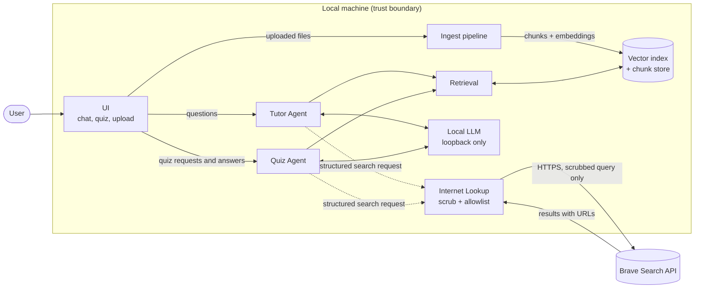
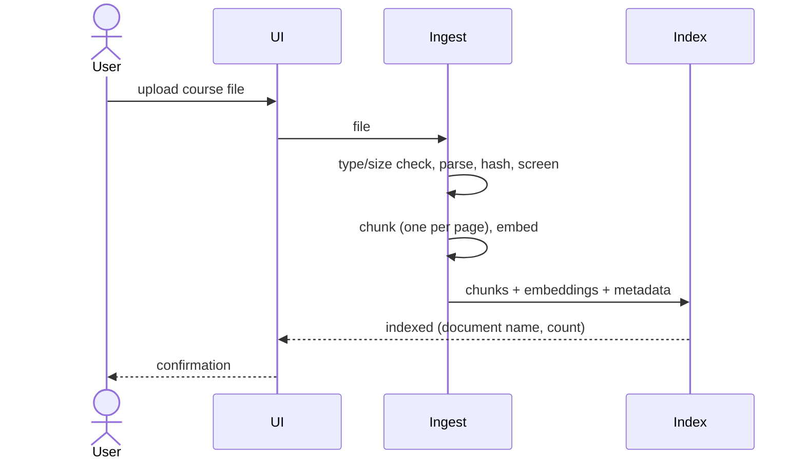
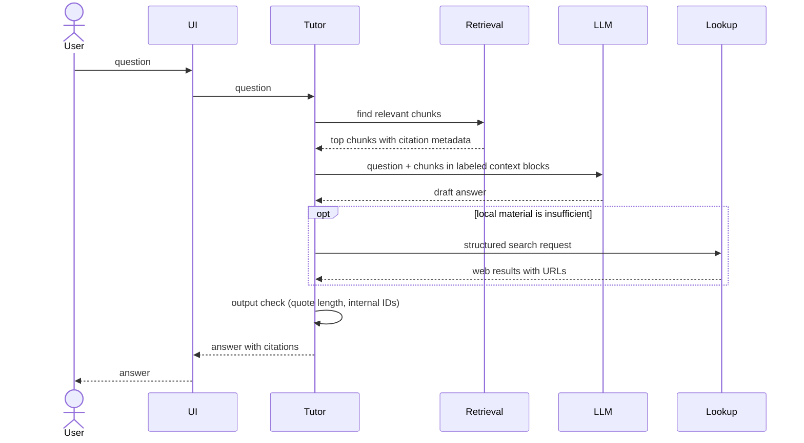
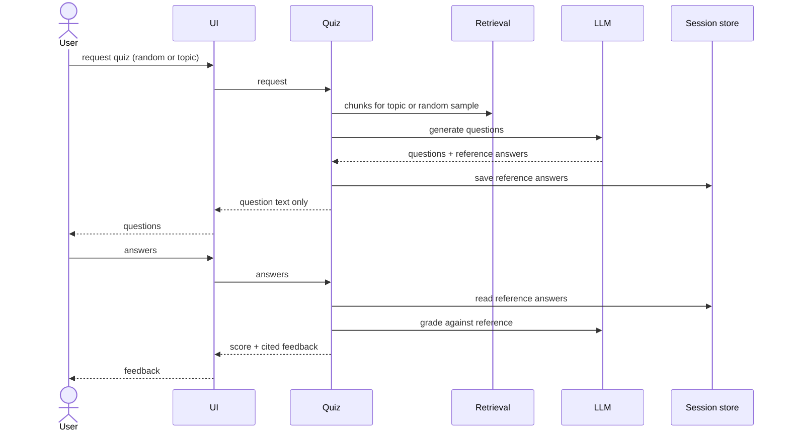
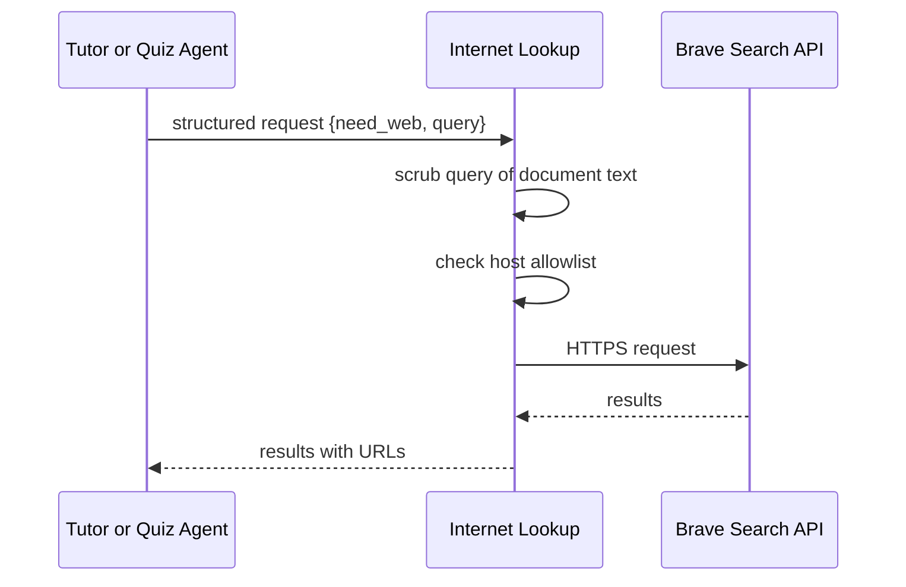
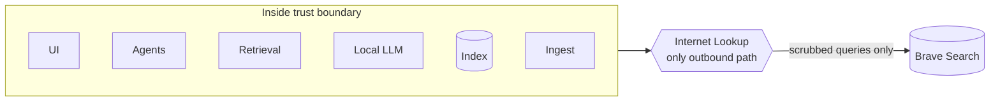

# Architecture

Status: High-level draft. Component roles and communication are set. Process layout, model runtime, and storage details are still open (see section 5).

## 1. Overview

TutorAndQuizBot is a local question-answering and quiz system for network security course material. A user uploads course files, asks questions, and takes quizzes. Answers and feedback cite the source documents. Course content stays on the local machine. The only outbound connection is the Internet Lookup module, which sends scrubbed search queries and never receives document content.

## 2. Components and Communication

Solid arrows show the normal data path. Dashed arrows show a request that goes through the Internet Lookup module, which is the only component allowed to reach the network.

| Component | Role |
|---|---|
| UI | Single interface for chat, quiz sessions, and document upload |
| Tutor Agent | Answers questions from retrieved material, with citations |
| Quiz Agent | Generates quizzes, holds reference answers, grades responses, gives cited feedback |
| Retrieval | Finds the most relevant chunks for a question or quiz topic |
| Vector index and chunk store | Holds embeddings and chunk text with source metadata |
| Ingest pipeline | Validates, parses, screens, hashes, chunks, embeds, and indexes files |
| Local LLM | One local Llama model serving both agents |
| Internet Lookup | Scrubs outbound queries, enforces the host allowlist, returns cited results |

## 3. Main Flows

### 3.1 Ingestion

Each chunk keeps its document name, section heading, and page or slide number, so citations can point to a specific location.

### 3.2 Tutor Question

The model treats retrieved text as reference material, not as instructions.

### 3.3 Quiz

Reference answers never leave the server side before the user submits.

### 3.4 Internet Lookup

Agents never make network calls themselves. They only send structured requests to the lookup module.

## 4. Trust Boundary

Everything except the Internet Lookup module stays inside the boundary. The threat model describes the risks at this boundary.

## 5. Decisions and Open Items

### 5.1 Decided

**Model runtime: Ollama** (decided 2026-11-02, TUT-56).

Chosen over the llama.cpp server and llama-cpp-python because it installs in one command on all
three team operating systems, whereas the alternatives need per-platform build steps. Ollama also
**binds to `127.0.0.1:11434` by default**, so the "no outbound access" requirement for the local
model is satisfied structurally rather than by configuration we have to maintain. Verified on the
reference machine: Ollama 0.40.13, listening on loopback only, `llama3.2:3b` answering correctly at
~17.7 tok/s on CPU.

**One base model with two prompt profiles** (decided 2026-11-02, TUT-57).

Not merely the simpler option — the only one that fits. `llama3.2:3b` holds ~2.4 GB resident
(Ollama reports 2.6 GB at a 4096-token context). The reference machine has ~5 GiB free after the
desktop session, so a second concurrently loaded model would not fit, and a 3B plus an 8B pair
certainly would not. The prompt profile is therefore a parameter of the single `llm/` wrapper, and
separate adapters are ruled out for the base build.

The two decisions above assume CPU inference: the reference machine has Intel Arc integrated graphics
and no CUDA. Teammates on Apple Silicon will see faster results through Metal, with no code difference.

**Vector store: `faiss-cpu`, one flat index** (decided 2026-11-07, TUT-58).

Faiss was the planned option, and measuring the corpus closes the question rather than reopening it.
The whole semester is **~250 chunks** (27 lecture decks, 275 non-empty pages), which is orders of
magnitude below the size where an approximate index earns its complexity. So `IndexFlatIP` over
normalised 768-dimension vectors: exact nearest-neighbour search, no training step, no recall to tune.

The deciding factor is not search quality, which is exact either way, but how the index persists.
`faiss.serialize_index()` hands back the whole index as one buffer, which is exactly the shape TUT-49
needs: AES-256-GCM over a single blob, and no partially-written plaintext on disk in between. A store
owning its own on-disk directory layout would have to be encrypted file by file, and a swapped file
would be undetectable.

Two corrections from implementing it (TUT-58, `ingest/index.py`):

- **It returns a numpy `uint8` array, not `bytes`.** Harmless, but the encryption wrapper needs the
  conversion rather than assuming a bytes-like buffer arrives.
- **"A swapped file would be undetectable" turned out to apply to *this* design too**, not only to the
  alternatives. There are two files — the index and its sidecar — and comparing vector counts does not
  pair them: two indexes holding the same number of chunks, which is unremarkable across uniform
  lecture decks, can have their vector files exchanged and the result loads cleanly, answering with one
  document's vector while citing another's filename and page at a similarity of 1.0. Measured, before
  it was fixed. Each write therefore stamps a random `generation` token into both files and load
  refuses a pair that disagrees, which means the vectors file is a short header plus the faiss buffer
  rather than the bare buffer. **Consequence for TUT-49:** the associated data should bind each file's
  name *and* its generation, so an encrypted file cannot be replaced by an earlier encrypted version of
  itself either.

Qdrant, Weaviate and Milvus are ruled out on the criterion TUT-58 sets for itself: each runs as a server
with a listening socket. That contradicts "fully locally with no network listener", puts a second
process inside the trust boundary of section 4, and leaves persistence outside our control precisely
where R2 needs it inside.

Chunk text and citation metadata do **not** live in the Faiss index, which stores vectors only. They go
in a sidecar keyed by vector id under `data/index/`, covered by the same TUT-49 wrapper.

**Embedding model: `nomic-embed-text` via Ollama** (decided 2026-11-07, TUT-65).

This had no ticket and two contradictory answers in the repo: README.md tells everyone to
`ollama pull nomic-embed-text`, while the `ml` extra in `pyproject.toml` declares
`sentence-transformers` and `torch`. Either path works; carrying both is what does not.

Ollama wins for the same reason TUT-56 chose it as the runtime: it is already installed, loopback-only
by default, and the `ollama` client is a default dependency rather than part of the 2–3 GB `ml` extra.
`nomic-embed-text` is 274 MB against `sentence-transformers` plus `torch` at 2–3 GB, and it reuses a
runtime the project already depends on instead of adding a second inference stack with its own model
cache for R2 to account for.

Measured on the reference machine: **768 dimensions, 2048-token context, ~13.2 chunks/s** on CPU, steady
from 10 to 100 chunks per call. The whole semester therefore embeds in **about 20 seconds**, which
confirms the interface doc's expectation that no stage is slow enough to need a progress bar for its own
sake.

The 2048-token context also settles `TXT_PAGE_TARGET_CHARS` in the ingest pipeline: 1500 characters is
roughly 375 tokens, so that guess stands with ~5.5× headroom and does not need to change.

Consequence for the `ml` extra: `sentence-transformers` and `torch` are no longer needed and should come
out, leaving `faiss-cpu` and `streamlit`. That is a dependency change, tracked on TUT-66 rather than
done here.

### 5.2 Still open

- **Process layout.** The system will run as several processes, but the split and the communication method depend on the team's operating systems (Windows, Linux, macOS).
- **Citation granularity.** Page or slide numbers are likely sufficient, but PDF section detection may need work.
- **Ingest isolation.** Whether parsing runs in a separate process depends on the process layout decision and on whether malicious file ingestion becomes R4.
